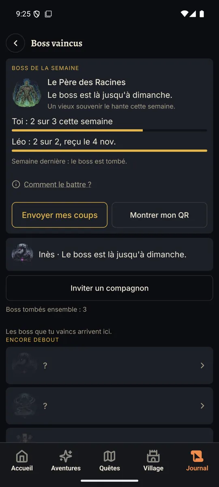
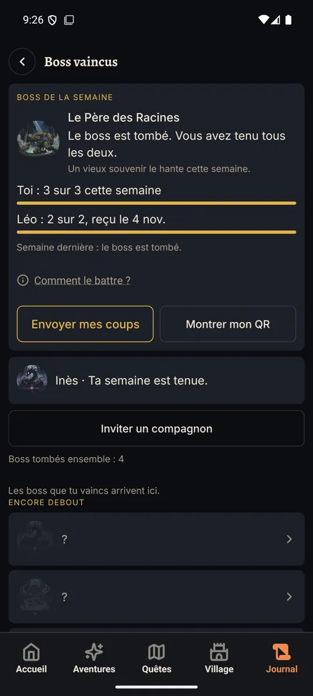
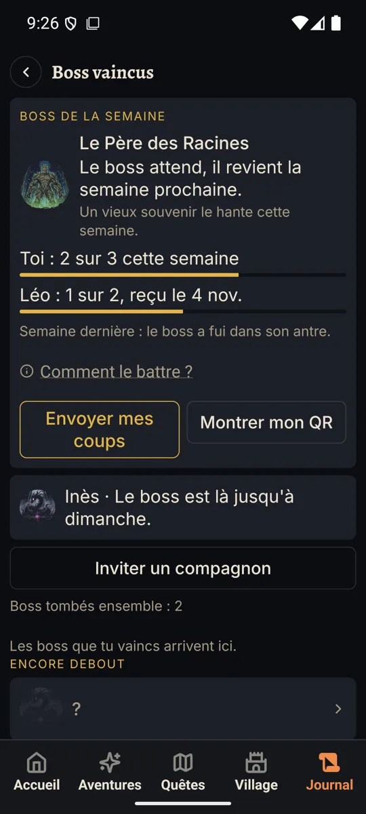
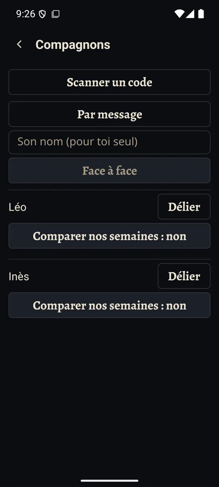

# Lot 1 : le rapport

**Le défi à deux est construit, derrière le drapeau, et marche sur une build de release : la carte du boss, la ligne de
la victoire, les compagnons, l'envoi par lien ou QR, la semaine tombée, enfuie ou gelée.** Les huit scénarios à deux
téléphones tournent en tests sur deux vraies bases. Le secret supprimé quitte enfin le WAL, mesuré. La PR attend ton
essai sur téléphone et neuf petites décisions, plus bas.

## Ce qui a été construit

| Étape | Livré | Temps (environ) |
| --- | --- | --- |
| L1 Spec | [LOT1-SPEC.md](../LOT1-SPEC.md), deux tours d'audit (6 personas + Inès), aucun ❌ restant | 0 h 08 |
| L2 Semaine | `duoWeek` pur (`src/multiplayer/duoWeek.ts`), `0085` (`pairs.goal`, `duel`, `reply`, table `duo_weeks`), ma semaine relue par R1, fusion entre mes appareils, copie en clair et délier qui vident ce qu'a dit l'autre | 0 h 10 |
| L3 Envoi | kind 5 (paquet), vecteurs figés bâtis à la main, « Envoyer mes coups », réception par lien ou QR, horloge en avance mise de côté | 0 h 08 |
| L4 Écrans | carte sur Journal > Boss, ligne de la victoire, écran Compagnons réécrit, écran « Mon code », six langues, politique de confidentialité, glossaire | 0 h 12 |
| L5 WAL | `db/releasingStatements.ts` : Drizzle finalise une instruction après l'avoir lue | 0 h 06 |
| L6 Porte | trois builds de release, captures, mesure du WAL, deux tours d'audit sur la PR, suites complètes | 0 h 23 |

Total réel : environ 1 h, de 20:31 à 21:30, les builds et les audits ayant tourné en parallèle du code.

## Ce que les joueurs verront quand le drapeau tombera

- **Journal > Boss** : en tête, une carte par compagnon. Le boss de la semaine (un des six boss existants, tiré du pair
  id et de la semaine, le même sur les deux téléphones), la ligne d'état, une phrase d'ambiance ; « Toi : 2 sur 3 cette
  semaine », « Léo : 2 sur 2, reçu le 4 nov. » ; « Comment le battre ? » ; « Envoyer mes coups » et « Montrer mon
  QR » ; « Boss tombés ensemble : 4 ». Plusieurs compagnons : la carte la plus avancée ouverte, les autres en une ligne.
- **La victoire** : après une séance comptée, avec au moins un compagnon, « Défi à deux : 2 sur 3 cette semaine » et
  « Envoyer mes coups ». Rien d'autre.
- **Compagnons** : scanner, inviter par message (lien) ou en face à face (QR), rejoindre, les invitations en attente
  avec « Annuler », « Comparer nos semaines » par compagnon, délier en un tap.
- **Rien sur l'accueil, aucune notification, aucune XP en plus.** Flamme et serments intacts.

## Ce qui reste caché

Tout, derrière `MULTIPLAYER_ENABLED` : sans le drapeau, la carte et la ligne ne se montrent pas, `/pairing` et
`/duo-code` renvoient à l'accueil, `CAMERA` reste retirée du manifeste (`plugins/withAndroidTrimPermissions.js`, qui la
garde déjà quand `EXPO_PUBLIC_MULTIPLAYER=1` au prebuild). Le jour où le drapeau tombe : retirer `CAMERA` de cette liste,
l'ajouter à `fdroid/expected-permissions.txt` et au test des permissions, comme le dit le commentaire du plugin.

## Migration

`0085_duo_weeks` : trois colonnes sur `pairs`, une table. Ajout seul, `multi-migration-ok` (part avec `0082` à `0084`,
pas encore publiées). `feat/village-iso` s'arrête à `0081` : la branche qui fusionne en second renumérote.

## La porte

| Critère | Résultat |
| --- | --- |
| Les deux tiennent leur semaine : tombé des deux côtés | **oui**, test `duo-two-phones` ; le téléphone qui reçoit le dit à la réception et le compte tout de suite |
| L'un rate : enfui des deux côtés, aucun nom | **oui**, test ; sur émulateur, « le boss a fui dans son antre », aucun nom, y compris sur la ligne repliée |
| L'un se met en pause sans s'entraîner : gelé des deux côtés | **oui**, test (l'enveloppe part à zéro coup avec le bit de pause) |
| Le premier envoi de B porte la réponse d'appairage | **oui**, test ; B la renvoie jusqu'à ce qu'une semaine de A arrive |
| Une enveloppe tardive change une fuite en victoire | **oui**, test (le lien du lundi de B ouvert une semaine plus tard) |
| Un doublon ou une vieille enveloppe ne change rien | **oui**, test (« Rien de nouveau ») |
| Un 2e arrêt pour douleur : pas de coup, aucun mot d'échec | **oui**, tests `db-duo` et `duo-two-phones` |
| Une sortie du dimanche hors réseau envoyée le lundi | **oui**, test : elle compte pour la semaine du dimanche |
| Une horloge en avance, une semaine d'avant la paire | **refusées**, tests : rien ne tombe, le compte ne bouge pas |
| Vecteurs figés | nouveaux pour le kind 5, bâtis à la main à partir des kinds 1 et 4, qui se lisent toujours seuls |
| `npm test` | **vert à Paris et en UTC** (Node 26 local ; 6331 tests à Paris), voir « Ce qui n'a pas tourné » |
| `tsc`, biome | verts |
| `licenses:check` | vert, 902 paquets, aucun bloqué |
| Android lint | non lancé : la branche ne touche ni `app.json`, ni `plugins/`, ni `android/`, ni le lockfile, seuls déclencheurs du job |
| `deadcode` | **non lancé** : knip plante dans ce worktree (`File 'expo/tsconfig.base' not found`, sous Node 24 comme 26), sans rapport avec le diff. La CI le passera |
| WAL (L5) | **prouvé** sur build de release, ci-dessous |

### L5 : la mesure

Même méthode qu'au lot 0 bis, sur l'émulateur, en root, build de release `.multi` : créer une invitation par lien, lire
sa clé privée dans la base, appuyer sur « Annuler », chercher la clé dans les fichiers.

| | `bati.v3.db` | `bati.v3.db-wal` | clé trouvée |
| --- | --- | --- | --- |
| Avant « Annuler » | 4 Ko | 948 Ko | dans le WAL |
| Après « Annuler » | 508 Ko | **0 octet** | **nulle part** |

Le chiffre d'avant dit tout : sur ce téléphone de test, **aucun checkpoint n'avait jamais abouti**, toute la base vivait
dans le journal. La cause était un `.get()` de Drizzle resté sur sa première ligne, donc dans sa transaction de lecture.
`releasingStatements` finalise chaque instruction après lecture ; aucun `.prepare()` réutilisé n'existe hors des tests.
`envelope.md` et le commentaire de `flushLog` disaient l'inverse, ils sont corrigés.

## Captures (build de release, français)

| | |
| --- | --- |
|  |  |
| Semaine en cours, 100 %. Inès repliée | Boss tombé : image vaincue, compte de 3 à 4 |
|  |  |
| Semaine gelée, semaine dernière enfuie, 130 % : aucun nom, rien de coupé (le compte à 2 vient de mon SQL de test) | Compagnons à 130 %, boutons de 48 dp |

« Mon code » à 130 % : [mon-code-130.webp](lot1/mon-code-130.webp). La ligne de la victoire n'a pas de capture : il faut
jouer une séance comptée entière ; elle a un test de rendu (`duo-victory-line`).

## Ce qui a raté, et ce que ça a appris

- **L'audit de la PR a trouvé une vraie triche** : rien ne bornait la semaine d'une enveloppe reçue, un compagnon
  pouvait sceller des semaines d'avant la paire et gonfler pour toujours un compte qui ne baisse jamais. Bornée, testée.
- **Une semaine tenue n'était comptée que si l'on ouvrait la carte.** Elle l'est maintenant là où elle arrive : à la
  réception d'un lien, et à la victoire.
- **La copie en clair gardait plus que ce que promet la politique** (les semaines non tombées, la date du dernier
  envoi). Corrigé, testé.
- **Mon premier build a peut-être emporté des fichiers en cours d'édition** : Metro empaquette tard dans Gradle. Refait
  depuis un commit propre, et les captures viennent du dernier.
- **Le prebuild avec le drapeau réécrit le manifeste commité** (il y retire la ligne `CAMERA`), ce que le test du
  manifeste attrape. Remis à la main deux fois ; ne jamais commiter `android/` après un tel prebuild.
- **Deux de mes propres raccourcis**, vus en relisant : un nom TalkBack fabriqué par une regex, un test qui « attendait »
  par un `findBy` voué à échouer. Remplacés.

## L'audit personas

Spec : deux tours, quatre agents Sonnet neufs, 2 en parallèle au plus. PR : deux tours, quatre agents neufs. Aucune
ligne rouge franchie. Un ❌ au tour 2 de la PR (la semaine non bornée), corrigé.

**Corrigé :** la pause qui ne partait jamais sans séance ; la pause finie en milieu de semaine ; les cibles de 44 dp ; les
noms TalkBack de la carte, de « Délier » et du duel ; les messages muets pour TalkBack ; le champ du nom au-dessus d'un
bouton qui n'en veut pas ; l'écran « Mon code » vide en cas d'échec ; le compte à zéro affiché ; le mot « coup » mis au
glossaire, distinct des dégâts de campagne ; l'objectif borné de 2 à 4 à la lecture aussi.

**Écarté ou laissé :** « Délier » sans dialogue (ta décision du lot 0) ; le fondu au lieu de deux animations distinctes
pour la chute et la fuite (le texte dit déjà l'état, rien ne bouge en mouvement réduit).

## Ce dont j'ai besoin de toi

**L'essai sur téléphone**, build avec `EXPO_PUBLIC_MULTIPLAYER=1` au prebuild et à la build :

1. Journal > Boss, « Inviter un compagnon », « Par message » : le lien part, l'invitation apparaît avec « Annuler ».
2. Sur l'autre téléphone, ouvrir le lien, « Rejoindre » sous un nom : « C'est fait » et « Prévenir maintenant ».
3. Faire une séance comptée sur l'autre téléphone, « Envoyer mes coups » sur la victoire, ouvrir le lien chez toi : le
   compagnon apparaît, nommé par toi, avec sa semaine.
4. Les deux tiennent leur semaine : la carte dit « Le boss est tombé », sur les deux téléphones, le compte monte d'un.
5. Une pause sans séance : la carte dit « Ta pause n'est pas encore partie », envoyer, l'autre lit « Le boss attend ».
6. « Montrer mon QR » scanné par l'autre en vrai, à l'intérieur et dehors. La caméra n'est demandée qu'au scanner.
7. TalkBack sur la carte et sur la ligne de la victoire : l'état est dit, chaque bouton a son nom.
8. À 130 % et 200 % de police, en russe aussi : rien de coupé.
9. Fermer la feuille de partage sans rien envoyer : voir le point 10 ci-dessous.

**À trancher** (aussi dans [STATE.md](../STATE.md)) :

1. **La carte vit sur Journal > Boss**, faute d'onglet Boss dans la barre.
2. **« Léo : 1 sur 2 » hors duel**, comme ton brief le demande, ou « Léo a envoyé ses coups le 4 nov. » sans compte.
3. **L'usure** : six boss, six affixes, un compte cosmétique.
4. **Objectif borné de 2 à 4**, les bornes du serment.
5. **Un objectif qui ne peut que baisser** après une blessure ? Pas fait : tu as écrit « figé ».
6. **« Prévenir Léo » juste après une pause**, hors de l'écran Boss ?
7. **Dire la chute du boss sur la victoire**, contre le « rien d'autre » du § 5.4 ?
8. **Le compte de l'autre peut baisser** si sa nouvelle enveloppe a moins de jours ; un boss tombé ne recule jamais.
9. **Deux compagnons aux objectifs différents** : la victoire prend l'objectif du premier.
10. **Android dit « partagé » même quand on ferme la feuille** : la ligne « Ta pause n'est pas encore partie » s'efface
    alors trop tôt sur ce téléphone. Marqué `shortcut:` dans `sendCoups.ts`.

**À savoir :**

- **Fiches Play et F-Droid, Sécurité des données** : la caméra et le partage entre joueurs devront y entrer le jour où le
  drapeau tombe, comme dans `privacy.md` (déjà fait, en anglais et en français, et dans l'app en six langues).
- **La restauration d'une copie en clair** efface les compagnons et garde le compte ; le message qui le dirait avant de
  restaurer n'est toujours pas écrit (dette du lot 0).
- Les traductions de, es, ru et zh sont d'un agent : « coup » y est Treffer, golpe, удар, 打击 ; une relecture native
  ne ferait pas de mal, surtout le russe « дуэт-вызов ».
- `deadcode` n'a pas tourné ici, voir la porte.
