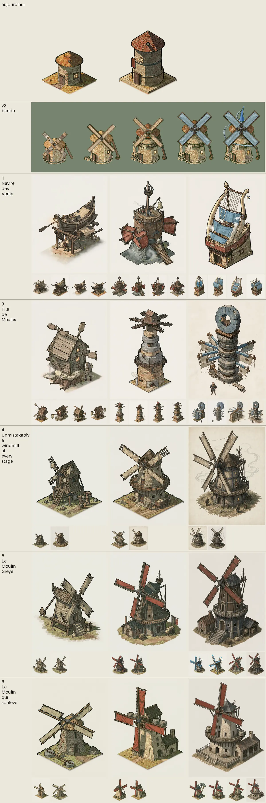
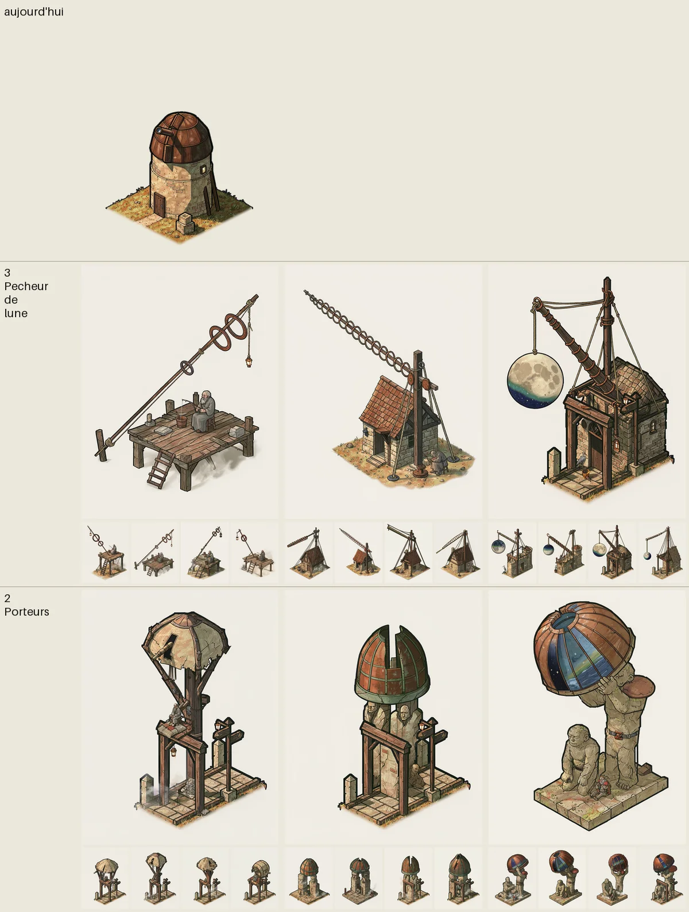
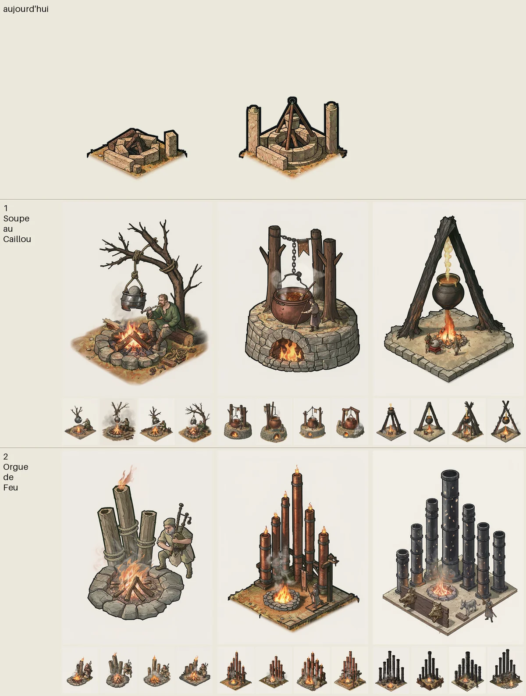
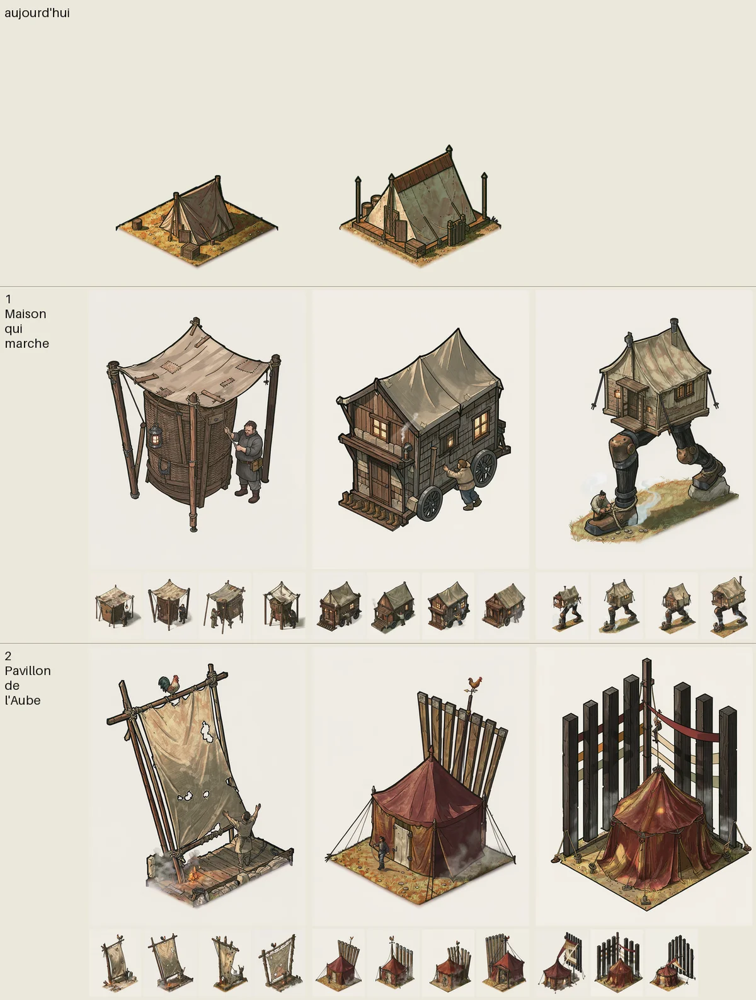
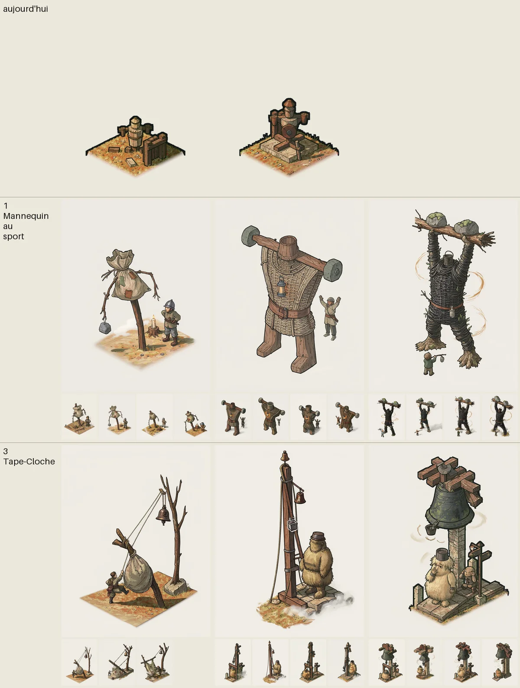

# Checkpoint 1 : le pilote et la vague 1, à toi de choisir

Écrit le 03/11. Pour chaque bâtiment : **une direction, ou un mélange** (« rough de 1, mythique de 2 »), avec 3 notes au plus. Écris sur la ligne `Choix :`. La production de chaque bâtiment démarre dès que son choix est écrit, sous réserve de la question 1. Les détails sont dans `<bâtiment>/ideas.md` et `<bâtiment>/audit.md`.

Lecture des planches : colonnes rough, grand, mythique ; première ligne, l'art d'aujourd'hui. Les grandes images sont repeintes sur FLUX 3, les petites sont les 4 variantes Klein, à coût réduit. Ce sont des concepts : les défauts listés se corrigent en production. Mara a relevé les erreurs d'image, personne n'a jugé tes idées à ta place.

## 3 questions d'abord

**1. Budget FLUX, bloquant pour la production complète.** Il reste 17,56 $ au registre (57,30 $ sur 75 $), plafond réel de la session. Estimation à la louche, d'après les 3,62 $ de peinture du moulin en session 1 : 3 à 4 $ par bâtiment, soit 15 à 20 $ pour ces 5, plus environ 8 $ pour les planches des 16 autres. Cela ne tient pas. Je n'écris pas `BUDGET_FLUX_V1`, cette ligne est la tienne.
- a) Tu montes le plafond dans `VALIDATIONS.md` : je fais tout.
- b) Plafond inchangé : les planches de toutes les vagues d'abord, puis 2 ou 3 bâtiments, dans l'ordre que tu donnes.
- c) Plafond inchangé : production d'abord, ces 5 bâtiments, et j'arrête les planches après la vague 2.

Sans réponse, je continue les textes et les planches comme le dit le prompt, et je ne lance pas de production au-delà de ce qui reste. Réponse : ___

**2. `VillageScene.tsx:514` fait évoluer seul un bâtiment prêt, sans tap, ce qui contredit la promesse.** Question reportée de la session 1. Derrière le drapeau par rang, ce chemin ne réclame plus rien. Ce comportement devient-il le bon pour tout le monde ? Je recommande oui : un joueur verra plusieurs bâtiments à toucher un par un après une séance. Oui / non : ___

**3. Doublons entre bâtiments, relevés par le vétéran.** Tes choix ci-dessous les règlent, mais à connaître avant de choisir :
- Corps colossaux : jambes de la tente 1, géant d'osier du mannequin 1, Porteurs de l'observatoire 2, plus le Hall of Heroes à venir. Il en veut un seul, la tente.
- Instruments : lyre du moulin 1 et orgue du feu 2. Il en veut un seul.
- Cabane sur pattes : tente 1 au mythique, et le rough de la pile de meules du moulin 3 le rappelle.

---

## Moulin

- **1, Le Navire des Vents** : barque retournée en toit, puis coque debout, et une lyre de côtes sur le toit au mythique. Premier des 4 lecteurs.
- **3, La Pile de Meules** : des meules enfilées sur un mât, comme une barre chargée, avec la cabane du premier jour perchée en haut. Deuxième des 4 lecteurs.
- Ligne « v2 bande » : le moulin A classique de la session 1, pour comparer.

À savoir : le mythique de la 3 a été repeint une fois (pneus et poutrelles en treillis) et ses cerclages se lisent encore un peu en pneus, avec des toiles pendantes. Le mythique de la 1 a aussi été repeint pour que ses cordes se lisent, avec des dorures à éteindre.

Choix : ___

## Observatoire

- **3, Le Pêcheur de lune** : une lunette en cerceaux si longue que le Sage a pêché la lune, et une seule figure la retient. Pas d'astrolabe ni d'atlantes. En tête des 4 lecteurs, sans unanimité.
- **2, Les Porteurs** : deux géants sortent peu à peu de leurs piliers, l'un se lève avec la coupole à l'épaule, un coussin dessus. C'est la voie des atlantes que tu avais demandée. Elle était à égalité de points avec la direction 1, L'Escalier du ciel, écartée : c'est mon arbitrage.

À savoir : la lecture trébuchet reste possible sur la 3 au grand. Sur la 2, un seul pilier fourchu au rough, et le géant de gauche est assis plutôt qu'à genoux. Rough et grand de la 2 repeints sans portique, mythique de la 3 aussi.

Choix : ___

## Feu de camp

- **1, La Soupe au Caillou** : un caillou bout dans un vieux casque, et à la fin un chaudron colossal nourrit le village. Préférée de mara et du débutant, c'est celle qui se lit « camp » dès le jour 1.
- **2, L'Orgue de Feu** : de trois bûches creuses à un orgue de flammes haut comme un clocher, et l'âne finit soliste. Préférée de theo et du vétéran : le meilleur mythique, et le rough le plus faible.

À savoir : sur la 1, le chaudron et la vapeur font trop butin, à éteindre. Sur la 2, le grand se lit distillerie et ses cuivres brillent, et les têtes de sanglier du mythique sont sur une barrière plutôt que sur l'orgue. Son mythique a été repeint.

Choix : ___

## Tente

- **1, La Maison qui marche** : une hotte d'osier, puis une roulotte, puis une maison sur deux jambes qui fait des fentes. Première de 3 lecteurs sur 4.
- **2, Le Pavillon de l'Aube** : un pavillon rouge et un immense éventail de lattes. Première pour mara, plus facile à peindre. Theo y voit le « sobre mais bien fait » que tu refuses.

À savoir : le rough de la 2 se lit drap qui sèche, et son mythique mur de prison, pas éventail. Le grand de la 1 se lit maison plus que tente. La direction 3 écartée, la tour de matelas, avait pour le débutant le rough le plus attachant : tu peux le reprendre en note.

Choix : ___

## Mannequin

- **1, Le Mannequin qui s'est mis au sport** : un sac sur un bâton qui n'arrive pas à lever un caillou devient un géant d'osier qui lève deux rochers, avec un coeur-lanterne qui bat la nuit. Première de 3 lecteurs sur 4.
- **3, Le Tape-Cloche** : on frappe le mannequin, un seau monte d'un cran par rang, et à la fin un enfant fait sonner la vieille cloche d'un doigt. Le curseur montre le progrès.

À savoir : le mythique de la 1 est presque de face et son osier dense fait du bruit. Il faut éviter toute lecture sinistre de l'homme d'osier. Le mythique de la 3 a été repeint.

Choix : ___

---

## Où on en est
- FLUX : 3,16 $ cette session. Moulin 0,64 $, les autres environ 0,50 $, plus 0,50 $ de reprises, dues à une référence de style qui recopiait son portique (retirée).
- Sous-agents : environ 30 sur 250.
- Pendant que tu lis : je continue les textes et les planches des vagues 2 à 5 pour un second checkpoint.
