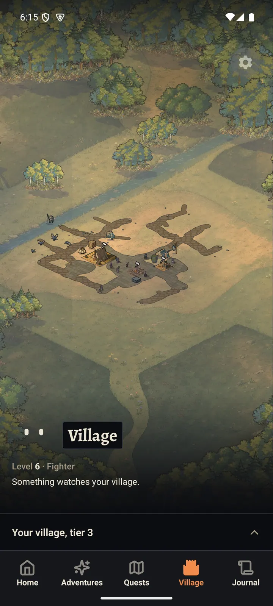
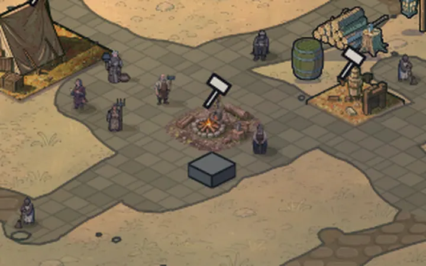
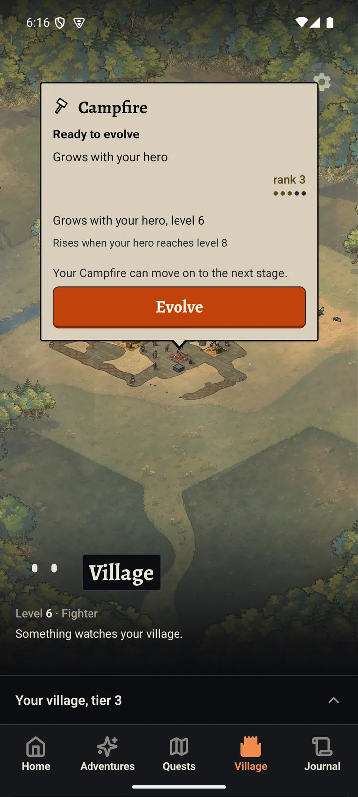
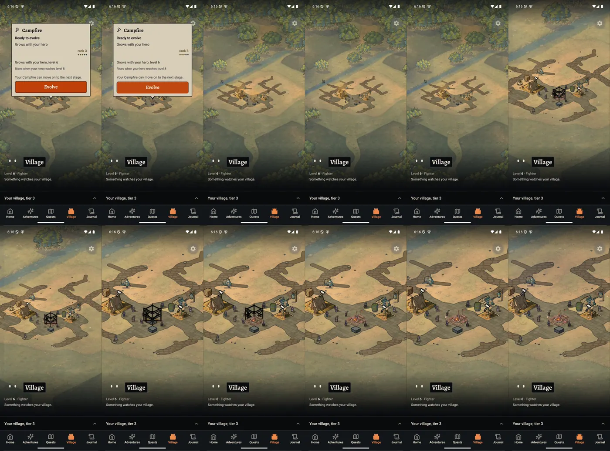
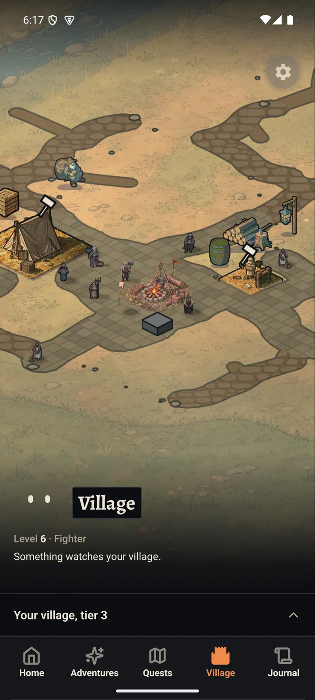

# Aperçu, non bloquant : le feu de camp dans le vrai onglet Village

Capturé sur `emulator-5554`, build de dev, tip `9bb40f57`. Rien à décider ici, je continue. Le feu de camp est le seul bâtiment intégré : ses voisins sont encore l'ancien art.

## Avant le tap : prêt à évoluer



## Le tap



## Après


## De nuit
Pas encore capturé : l'onglet suit l'heure, nuit à partir de 20 h, et l'émulateur n'est pas root. Je fais ajouter un réglage de dev pour la forcer, puis je capture.

## Ce qui marche
- Le nouvel art s'affiche dans le vrai onglet, drapeau allumé.
- Le tap ouvre la bulle, « Evolve » joue l'évolution, le marqueur disparaît du feu et reste sur la tente et le mannequin.
- Le passage du rang 1 au rang 3 en un seul tap est celui que décrit le prompt.

## Ce qui ne va pas, corrections en cours dans le code partagé
- **Cube gris foncé** posé devant le feu, à tous les rangs : un résidu, à supprimer.
- **Échafaudage noir de l'évolution :** il se lit vectoriel à côté de la peinture.
- **Environ 7 s** entre le tap et la bulle en build de dev : cause à chercher.
- **La caméra reste zoomée** après l'évolution : à vérifier.

## Pas vérifié
La relance de l'app après évolution, un rang de 5 ou plus, l'échelle mesurée. La base de dev est restée au niveau 6, avec du faux XP.

---

# Checkpoint : il manque une ligne

Tout ce qui ne coûte rien est fait. **La peinture attend le plafond FLUX :** 72,95 $ dépensés sur 75 $, 0,71 $ restants, et 1,34 $ réservés.

**Ajoute à `docs/designs/village-iso-v1/VALIDATIONS.md`, sous `## Lignes` :**

```
2026-11-03 BUDGET_FLUX_V1: 140
```

140 $ est mon estimation, faite de tête, pas une mesure : environ 3 $ par bâtiment pour 19 bâtiments, et 2 $ pour les planches du moulin et du puits. Écris le chiffre que tu veux. Je m'arrête à celui-là, et je m'arrête aussi à chaque alerte de 10 $ que je peux acquitter dans ce plafond.

Ensuite, relance-moi d'un mot : je ne surveille pas le fichier.

## Ce que tu verras au prochain checkpoint
Les planches du moulin et du puits (2 directions chacun, textes dans `windmill/ideas-v2.md` et `well/ideas-v2.md`), et le résumé de chaque vague finie. Je ne m'arrête pas pour autant : les autres bâtiments avancent pendant ce temps.

## À contredire si besoin, sinon je continue
1. **Direction retenue :** la 4 que tu as vue sur la page, et la 3 pour la fontaine. Ton message dit « le premier de l'audit » quand rien n'est choisi, mais cela ramènerait les directions à blagues. Détail dans `retours-concepts-2.md`.
2. **Deux tonneaux géants :** fontaine et Champion Arena. Tu as approuvé les deux idées séparément. Je les garde, le rédacteur a signalé le doublon.
3. **L'arène sans personne :** le bras de fer devient deux armures vides colossales, gantelets verrouillés au-dessus du tonneau, puisque tu ne veux plus de personnages.
4. **Mannequin :** mythique peint à partir de la variante avec un toit. **Feu de camp :** la cabane du rough est retirée.
5. **Puits 6 :** sablier retiré, il évoque un minuteur.
