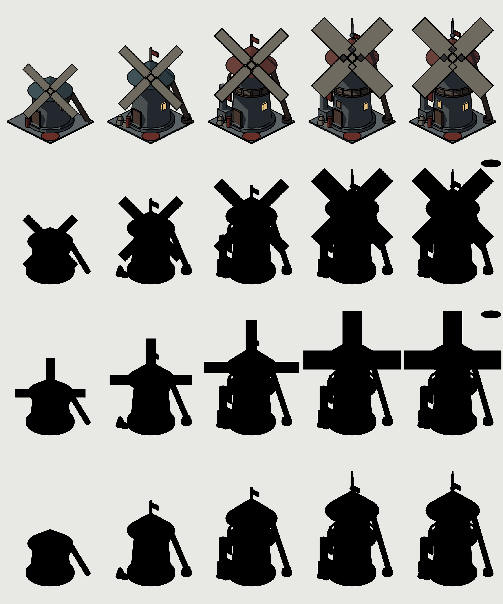
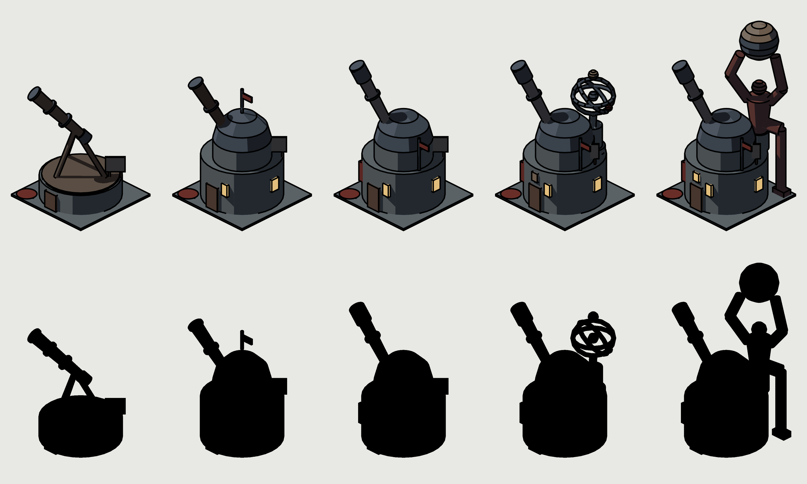

# Préparation des bâtiments : résumé

Date : 2026-11-02. Branche `bld-prep`, rebasée sur `feat/village-iso` à ta demande.
22 sous-agents utilisés sur 40. Aucun émulateur, aucun appel FLUX, rien de fusionné.

**En une phrase :** tout est prêt sauf un point, le mythic de l'observatoire échoue au test de
silhouette après les 3 tours permis, et c'est à toi de décider.

## La décision à prendre

Au tour 3, les deux étrangers nomment ce mythic « Champion Arena », net et flouté. Tous les autres
stades des deux bâtiments passent, flous compris. Le titan se lit enfin comme une figure qui porte
une boule, et c'est donc lui qu'on nomme.

Options :

- **Garder Atlas** et accepter l'échec sur la silhouette. La peinture et les bras d'orbite ajouteront
  des signes que ce noir n'a pas, sans preuve à ce stade.
- **Ajouter des signes célestes au noir** : bras d'orbite, lune, bandes sur le globe.
- **Réduire la figure** pour qu'elle serve le dôme.
- **Retirer la figure.** Le catalogue prévoit pourtant « Atlas at the Observatory », et c'est l'idée
  que theo préfère : « le bâtiment des épaules porte le monde sur les siennes ».

Limites du test : les étrangers sont des sous-agents, ils n'ont vu que ces deux bâtiments, et la liste
de noms est fermée. Le détail est dans [`maquettes/r3/g-id.md`](maquettes/r3/g-id.md).

## Les maquettes, tour 3

Couleur en haut, silhouettes en dessous, du rough au mythic. Le moulin a quatre rangées : ailes en X
en couleur, noir en X, noir en +, tour seule.

| Tour | S-A | S-B | Ce qui a échoué |
|---|---|---|---|
| 1 | 11/12 | 9/12 | Mythics flous, legendary de l'observatoire lu comme une tour de mage |
| 2 | 11/12 | 8/12 | Rough, grand (lu comme une grange), mythic net et flou de l'observatoire |
| 3 | 10/12 | 10/12 | Mythic net et flou de l'observatoire |

Le flou des tours 2 et 3 n'est pas celui du tour 1. L'outil faisait 96 px au lieu de 96 dp ; je l'ai
corrigé avec une densité supposée de 2,75. Cela rend le test plus facile, donc les tours ne se
comparent pas tout à fait.

Ce que le noir ne dit pas encore :

- Les silhouettes legendary et mythic du moulin ne diffèrent presque que par le nuage.
- Solid et grand de l'observatoire se ressemblent beaucoup. La carte le note comme non prouvé.
- Ces deux points relèvent de G-LADDER, pas encore testé.

## Ce qui est prêt

- **Table des stades** : `constants/buildingStages.ts`, les deux règles, désactivée par défaut, rien
  dans l'app ne la lit. Aucune baisse par rapport à l'ancien mapping.
- **Format par bâtiment** : `constants/buildingData.ts`, avec le moulin en exemple vide.
- **Scripts** : `scripts/bld/bldtools.py` (mélanges avec leurres, paires A/B, grille numérotée,
  empreinte, silhouettes et flou, planches, métriques G-SET, diff hors masque).
- **Rendu** : `gen_pilot_specs.py` puis `render_pilot.py <tour>`. Les specs sont dans
  `scripts/iso/blockouts/bld/`, à part de ceux de l'app.
- **Doc et état** : `pipeline.md`, `state.json`.

Vérifié : les 16 tests de la table, `tsc`, Biome, `npm run deadcode` et les autocontrôles Python étaient
verts à la fin de l'étape 2. Après le rebase, j'ai relancé les tests de la table, les autocontrôles et
`tsc`. Après le tour 3, seulement les autocontrôles Python.

## Les 5 cartes à relire

Brouillons non gelés, relus une fois par theo et mara, corrigés. Chacune finit par ses questions.

- [`moulin`](cards/windmill.md) : le chevalier et les géants, un orage tenu en laisse au sommet.
- [`observatoire`](cards/observatory.md) : l'astronome et le hibou, un titan qui porte le globe.
- [`feu de camp`](cards/campfire.md) : la saucisse volée, le cuistot danse avec la dernière.
- [`tente`](cards/tent.md) : la petite tente voisine, le chien finit avec le bonnet de nuit volé.
- [`mannequin`](cards/training_dummy.md) : le mannequin rend les coups, un manège géant penché pour
  ne pas lire un gibet.

## Les autres questions

Sur les cartes pilotes :

1. **Orage en laisse ou cristal** au sommet du moulin ? La carte prend l'orage (theo aussi). Mara note
   qu'il emprunte la grammaire du mythic de la tour du sorcier.
2. **Le Sage ou un astronome anonyme** à l'observatoire ? Theo vote le Sage, mara l'anonyme. La carte
   prend l'anonyme.
3. **Le jour de la mise à jour**, jouer le show pour un bâtiment redessiné dont le stade ne change pas ?
   Sans lui, le solid de l'observatoire change en silence.
4. **Teintes** : bleu des ailes `#9DB8C2`, patine `#5E8A80`. Propositions non testées.
5. **Règle B** : le legendary d'une amélioration suppose-t-il son rang propre 3 ? La table et la carte
   le supposent.

Sur les fondations (3 cartes) :

6. **Feu, mur du r7** : z 1,45, ou z 1,1 pour que l'échelle se lise à l'écran et que les bûches dépassent ?
7. **Feu, r6** : le sanglier rôti compte-t-il comme accessoire ? Sinon le cuistot sort du rang pour
   rester à 2 figures.
8. **Feu, r8 et r9** : le chien et le cuistot vus de dos ou de trois quarts dos, acceptable ?
9. **Tente, r8 et r9** s'écartent du catalogue (pieds qui dépassent, saucisse, bonnet volé). D'accord ?
10. **Tente** : le chien reste celui du gag, pas l'animal gardien du joueur. D'accord ?
11. **Mannequin, bras du manège** : il dépasse l'emprise de 0,27 en l'air. Exception, ou bras raccourci
    à 39 dp, décentré ?
12. **Mannequin, visage** : deux croix en guise d'yeux, malgré la règle « pas de lettres » ?

Un écart à trancher : le prompt parle encore d'un garde-fou APK de 55 MiB, retiré le 18/10 selon
`AGENTS.md`.

## Non fait, non vérifié

- **Hors de cette préparation** : états de capture et cartes de calibration (il faut l'app ou les
  juges calibrés), moteur partagé, référence FLUX, sondes.
- **Hauteurs** : `iso-layout` et `heights.py` ne lisent pas `blockouts/bld/`, donc les hauteurs
  nouvelles (jusqu'à 4,02 pour l'observatoire) ne passent par aucun contrôle d'écart d'ombre.
- **Empreinte** : le contrôle passe mais il est faible. Il ne compare qu'une bande de 12 px au coin
  avant, que tous les stades partagent par leur dalle.
- **Silhouettes** : le nuage y est une simple ellipse, ni la chaîne, ni les bras d'orbite, ni les gags.
- **Cartes des fondations** : aucune maquette, tailles et ombres calculées à la main.
- **Suite complète** : `npm test` n'a pas été lancé, seulement la suite de la table.
