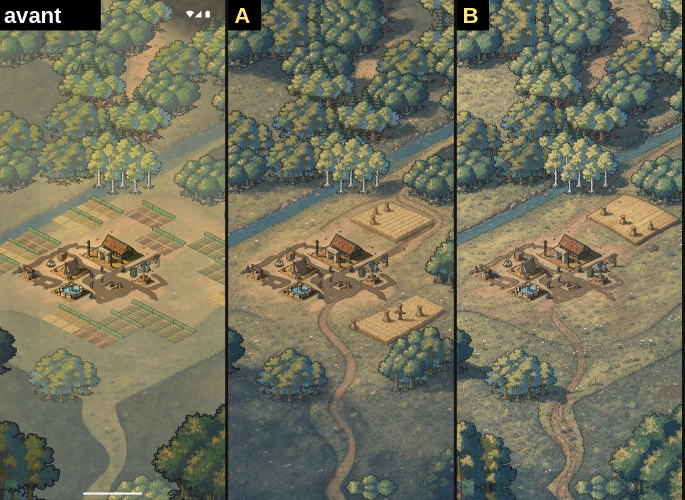
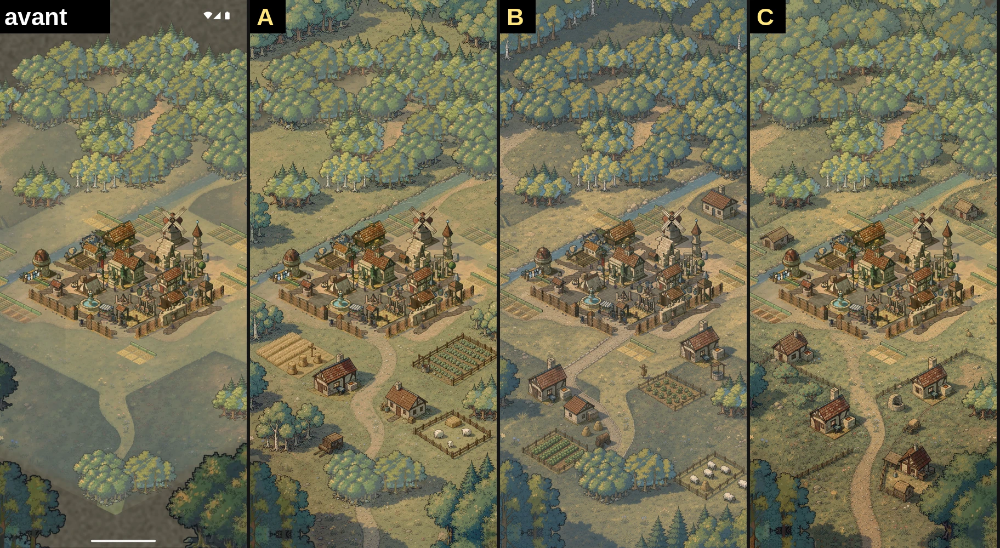
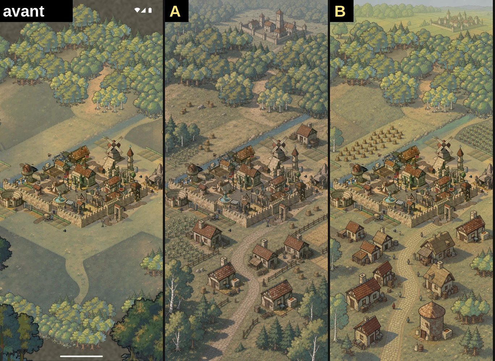
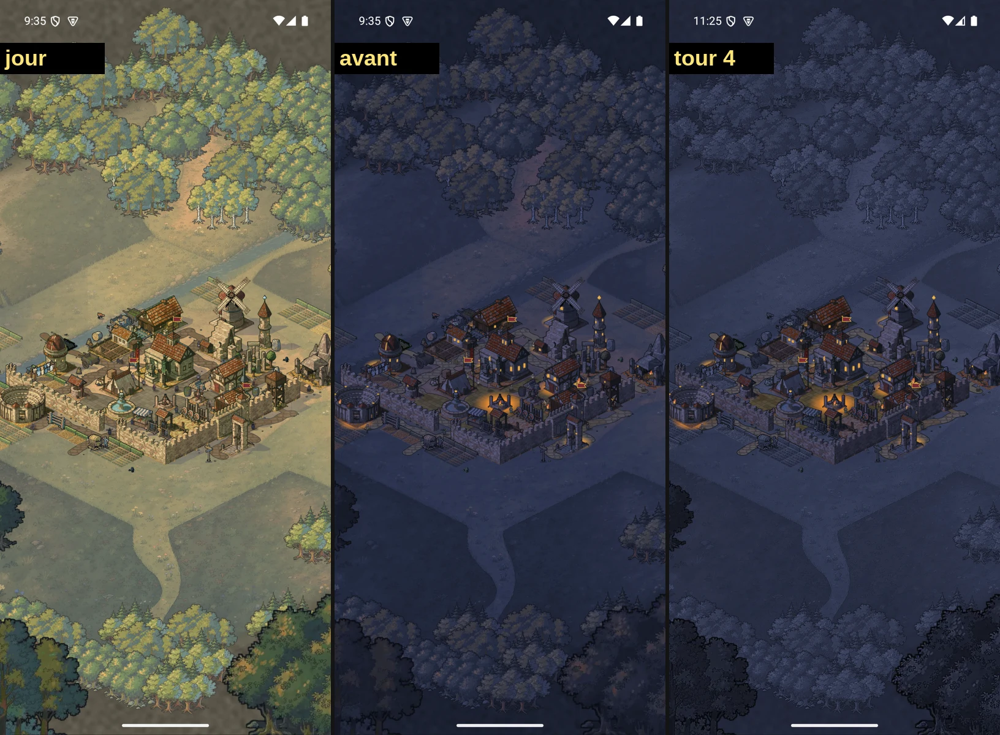

# Checkpoint de l'étape 0

**Réponse de Guillaume, 02/11 : « on suit tes reco », soit `1 A A A, 2 oui, 3 oui, 4 P`.** Il a écrit la ligne de budget lui-même : plafond 60 $. Les écrans choisis sont dans `targets/<état>/cible.png`.

Étape 0 finie. Il me faut 4 réponses avant le coin de beauté. Réponds par exemple : `1 A A A, 2 oui, 3 oui, 4 P`.

Pendant ton absence, j'ai aussi tenté S-night, qui ne coûte rien en FLUX. **Elle a échoué** et n'est pas fusionnée. Du coin de beauté, seules les fondations sans FLUX sont faites, sur la branche `loupe-bc`, non fusionnée : arbres fixes retirés (G03), cuiseur de sol et manifeste de tampons, checks `core` et `forest`. Ni peinture ni tour : la suite demande 8 à 12 $, et il en reste 3,55 $.

## 1. Quel écran cible par palier ?

**Palier 1**

- **A (recommandé)** : clairière nette, piste de terre, meule et épouvantail.
- B : même idée, mais il reste un grand arbre dans le coin bas à droite.

**Palier 6**

- **A (recommandé)** : hameaux et champs vivants, le plus proche de ta liste.
- B : le plus riche en forêt, avec les quatre champs bien lisibles.
- C : hameaux seuls, plus calme.

**Palier 12**

- **A (recommandé)** : faubourg le long de la route, ville au loin sur la terre ferme, sans ciel.
- B : plus d'abondance, mais une bande de ciel en haut, donc une caméra moins juste.

Il reste des arbres de coin sur certaines images. Ils partiront quand même en jeu (G03). Le palier 12 n'a que deux choix : deux autres variantes sont écartées car des bâtiments avaient bougé (15 et 30 px). Tu peux aussi refuser un palier en une ligne, pour une seule régénération (1 $ au plus).

## 2. Budget FLUX : à toi d'écrire la ligne

Dépensé : 36,45 $ sur 40 $, dont 2,03 $ cette session. **Reste : 3,55 $.** Le coin de beauté et R1 ont besoin de 13 à 20 $ (estimation). La ligne n'est toujours pas dans `VALIDATIONS.md`, et je n'ai pas le droit de l'écrire.

- **Oui (recommandé)** : écris `2026-11-02 BUDGET_FLUX_V1: 60` sous `## Lignes` de `docs/designs/village-iso-v1/VALIDATIONS.md`.
- Non : je m'arrête aux sondes du coin de beauté, 3 $ au plus.

## 3. Routes et champs peints : je modifie la bible ?

La bible des abords dit « chemins et champs restent dessinés par le code ». Le prompt de phase 2 les demande peints (G04, G05, G06). Les deux ne tiennent pas ensemble, et le contrat du coin de beauté en dépend.

- **Oui (recommandé)** : ils deviennent peints et cuits dans le sol, et j'écris ta décision dans la bible.
- Non : ils restent en code, avec un meilleur dessin, sans peinture.

## 4. S-night : on fait quoi de la nuit ?

4 tours, le maximum. **Résultat : les mesures progressent, mais la périphérie y perd, et le tour ne remplit pas les conditions de fin.**

- Corrigé : le sol a du relief (0,37 à 0,68, il fallait 0,60), les champs ne brillent plus en orange, et on reconnaît encore leur culture à l'aveugle (3 sur 3).
- Le critère de rang échoue encore : p12 à 0,985 pour 0,987. Le seuil vient d'un resserrage automatique que j'ai appliqué au contrat. La baseline était à 0,974. Il bute sur les rues du code, hors de la loupe.
- **A/B : 0 gain sur 9 selon la règle, mais le test ne tranche pas vraiment.** Un contexte a manqué le canari deux fois, donc il est nul : sa relance donne les 10 paires à la baseline. L'autre est valide et partagé : 5 extraits pour le tour 4 (village, sol, fenêtres, lisière, feu), 4 pour la baseline (champs nord et est, route, villageois), avec un fort biais vers l'image de gauche (9 sur 10).
- **Env est plus net, sur images** : le sol et le cœur vont mieux, mais **forêt d'un seul bleu**, essences perdues, **blé gris comme de la cendre**, **pavés ocre qui brillent** en flaques sur le sol bleu, étal et accessoires gris au cœur du village. À l'œil, je partage son avis.

Ma lecture : mes critères de couleur ont poussé toute la périphérie sous un seul filtre bleu. C'est mon contrat qu'il faut revoir plus que le travail.

- **P, parquer (recommandé)** : la nuit actuelle reste en place, `loupe-s-night` reste de côté, et on passe au coin de beauté. On y revient après, sur les nouveaux assets, puisque la nuit en dérive.
- R, reprendre : 2 tours de plus, avec un contrat refait. On garde le relief du sol, on rend une teinte par essence et par culture, on abaisse la valeur des rues, on retire le critère de rang.
- F, fusionner quand même : à toi de voir sur l'image, je ne le recommande pas.

## À savoir, sans réponse demandée sauf si tu n'es pas d'accord

- **APK arm64 : 71,1 MiB**, au-dessus de la limite de 55 MiB du prompt, et ce avant toute loupe. `AGENTS.md` dit que tu as retiré ce budget le 18/10. Je mesure et je note sans bloquer. Dis-moi si la limite doit revenir.
- **H0, cache d'images** : pas de hash dans la clé de cache comme demandé, car `cacheKey` n'atteint pas les images embarquées (`res:`). À la place, l'empreinte des sprites vide le cache quand elle change. Les 3 tests passent.
- **Check vectoriel en pixels : abandonné.** Aucun k ne sépare le vectoriel du peint : le pré peint a 27 à 93 % de blocs plats, le rack et les fanions 0 à 60 %. G05, G06 et G08 reposent sur le check de code et les juges.
- **Calibration** : env réussit (5 défauts sur 6, 2 bons sur 3), il est juge 1. Mara échoue d'abord (1 bon sur 3), puis réussit le retest avec ses notes : 3 labels justes, mais une cause fausse sur la route et la porte. Je la garde pour l'A/B. Les deux ont manqué les arbres collés, qui ne se voient pas sur un seul extrait. Le dump le couvre.
- **Biais de l'A/B** : les juges penchent vers l'image de gauche. La double passe le neutralise, mais il faudra un canari plus franc au coin de beauté. Celui de S-night passait par la même courbe froide, donc il testait la même chose que le tour.
- **Écrans cibles** : premier tour trop timide, relancé avec un prompt plus strict, d'où 2,03 $ pour environ 2 $ prévus.

## Estimations de la suite

| Poste | FLUX | Passages de sous-agents |
| --- | --- | --- |
| Déjà utilisé | 2,03 $ | 15 sur 80 |
| Coin de beauté | 8 à 12 $ | 20 à 30 |
| R1 | 5 à 8 $ | 15 à 20 |

Je m'arrête à 64 passages (80 %), et chaque lot FLUX reste sous 10 $.
